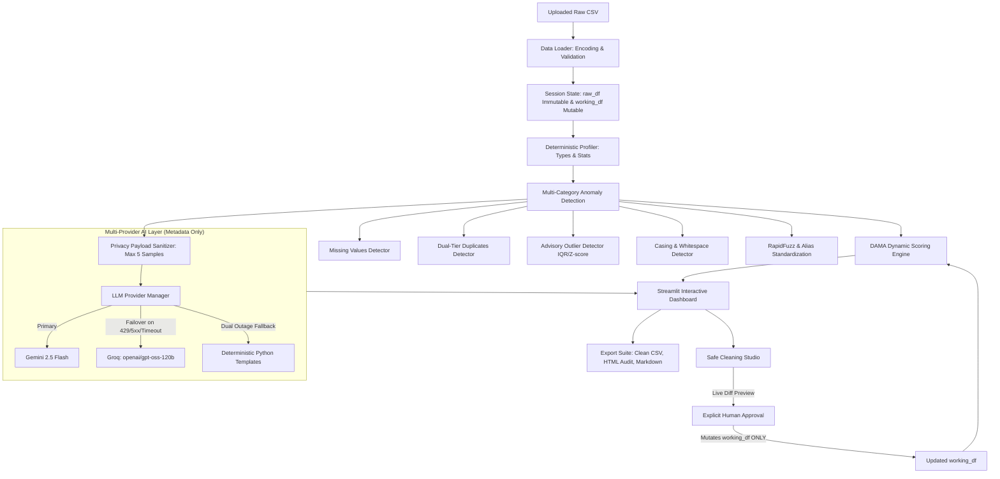
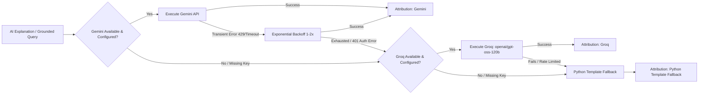

# 🛡️ DataGuard AI – Intelligent Data Quality & Anomaly Detection Agent

[](https://www.python.org/)
[](https://streamlit.io/)
[](https://pytest.org/)
[](#multi-provider-llm-failover-architecture)

> **DataGuard AI** is an enterprise-grade, privacy-first data quality agent that transforms raw, messy CSV datasets into pristine, validated assets. Combining deterministic Pandas & NumPy computation with a resilient dual-provider LLM failover architecture (Gemini & Groq), DataGuard AI profiles data health, catches multi-category anomalies, calculates DAMA-DMBOK aligned scores, and provides a safe human-in-the-loop cleaning studio with live side-by-side diff previews.

---

## 🌟 Key Highlights & Architectural Strengths

- **⚡ Blazing Fast Deterministic Core**: Profiles, detects anomalies, and computes DAMA quality scores across **10,000 rows in under 5.0 seconds** purely using Pandas & NumPy.
- **🔄 Multi-Provider LLM Architecture with Transparent Failover**:
  - **Primary**: Google Gemini API (`gemini-2.5-flash`).
  - **Secondary**: Groq SDK (`openai/gpt-oss-120b`).
  - **Deterministic Fallback**: Rule-based Python template engine guaranteeing 100% application uptime with zero active LLMs.
- **🔒 Privacy Boundary (Zero Raw CSV Leakage)**: Strictly transmits column metadata summaries and a maximum of 5 distinct sanitized samples to external LLMs. Full datasets never leave the local environment.
- **🛡️ Immutable Raw Data & Safe Cleaning Studio**: The original uploaded dataset (`raw_df`) is strictly immutable. Transformations operate exclusively on `working_df` upon explicit user approval, accompanied by interactive side-by-side before/after diff previews.
- **🎯 DAMA-DMBOK Dimensional Scoring**: Proportional dynamic re-weighting across Completeness (35%), Validity (30%), Consistency (25%), and Uniqueness (10%) that automatically excludes non-applicable dimensions.
- **🔤 Fuzzy Value Standardization**: RapidFuzz string clustering and configurable alias dictionaries categorize variations into confidence tiers: *Cosmetic (100%)*, *High Confidence (≥90%)*, *Medium (80-89%)*, and *Distinct (<80%)*.
- **📊 Comprehensive Audit Reporting**: One-click generation of standalone styled HTML reports, GitHub-flavored Markdown reports, and cleaned CSV exports.

---

## 🏗️ System Architecture



---

## 🔄 Multi-Provider Failover Flow



---

## 🚀 Quickstart Guide

### 1. Prerequisites
- Python 3.10+ (tested on Python 3.10, 3.11, 3.12, 3.13, 3.14)
- Git

### 2. Installation

Clone the repository and install dependencies:
```bash
git clone <repo-url>
cd hackathon

# Create and activate virtual environment
python -m venv venv
# Windows (PowerShell):
.\venv\Scripts\Activate.ps1
# Linux / macOS:
# source venv/bin/activate

# Install required packages
pip install -r requirements.txt
```

### 3. Environment Configuration (Optional for Gemini & Groq AI)

DataGuard AI runs **100% offline out-of-the-box** using deterministic rule templates. To enable Gemini and Groq AI assistants, copy `.env.example` to `.env`:

```bash
cp .env.example .env
```

Edit `.env`:
```ini
# Primary Provider: Google Gemini
GEMINI_API_KEY=your_gemini_api_key_here
GEMINI_MODEL=gemini-2.5-flash

# Secondary Provider: Groq
GROQ_API_KEY=your_groq_api_key_here
GROQ_MODEL=openai/gpt-oss-120b
```

*(Note: API keys are strictly guarded by `.gitignore` and sanitized from logs and UI banners).*

### 4. Launch the Streamlit Web Application

```bash
streamlit run app.py
```
Open your browser at `http://localhost:8501`.

---

## 🧪 Interactive Walkthrough

1. **Ingest Data**:
   - Drag and drop your own CSV file (up to ~10,000 rows), OR
   - Click **"🧪 Load Dirty Customer Demo Dataset (1,000 rows)"** in the sidebar to immediately load a benchmark dataset pre-seeded with real-world defects.
2. **Review Scorecard & Health**:
   - Inspect the overall health gauge and the 4 DAMA dimension bars (*Completeness*, *Validity*, *Consistency*, *Uniqueness*).
   - Review exact score deductions and column-level metrics in the Dynamic Column Health Explorer.
3. **Inspect Anomalies**:
   - Filter issues by category: Missing Values, Duplicates, Outliers, Casing & Whitespace, or Spelling Variations.
   - For numerical outliers, use the **Advisory Triage Control** to either whitelist them as natural business variance (removing the penalty) or flag them as defects.
   - Click **"Generate AI Explanation"** to view plain-English summaries, business impacts, and suggested remediation code with visual provider attribution.
4. **Standardize Values**:
   - Inspect RapidFuzz clusters and alias dictionary suggestions (e.g., `NYC` $\rightarrow$ `New York`, `San Fran` $\rightarrow$ `San Francisco`).
   - Click **"Send All High-Confidence Mappings to Cleaning Studio"**.
5. **Human-in-the-Loop Cleaning**:
   - Expand **"🔍 Preview Side-by-Side Diff Comparison"** to review exact before-and-after rows before any data mutation occurs.
   - Select desired actions and click **"🚀 Apply Approved Transformations"**.
   - Watch the scores dynamically recalculate on `working_df` while `raw_df` stays untouched!
6. **Download Reports & Clean Data**:
   - Export your cleaned CSV.
   - Download the standalone styled HTML audit report or Markdown report for executive stakeholders.

---

## 🧪 Running the Pytest Suite

DataGuard AI includes 47 automated tests covering every layer of the system:
```bash
pytest -v
```

### Test Coverage Summary:
- **`tests/test_benchmark.py`**: Asserts 10,000 rows profile, detect, and score in < 5.0 seconds.
- **`tests/test_data_loader.py`**: Verifies buffer, bytes, and path ingestion, encoding auto-detection, and bounds checking.
- **`tests/test_profiling.py`**: Validates type inference (numeric, categorical, datetime, boolean) and IQR distribution bounds.
- **`tests/test_scoring.py`**: Asserts DAMA dimensional scoring, proportional dynamic re-weighting, and score deductions.
- **`tests/test_detection.py`**: Verifies missing values, full-row duplicates, business-key duplicates, advisory outliers, and casing/whitespace issues.
- **`tests/test_standardization.py`**: Tests RapidFuzz similarity thresholds and confidence tier categorization.
- **`tests/test_ai_agent.py`**: Tests Gemini success, 429 rate limit failover to Groq, 401 auth immediate failover, dual outage template fallback, and privacy boundary enforcement.
- **`tests/test_cleaning.py`**: Verifies that `raw_df` is strictly immutable, diff previews are accurate, and transformations mutate only `working_df`.
- **`tests/test_report.py`**: Asserts valid Markdown and HTML report generation with provenance tracking.
- **`tests/test_security.py`**: Asserts zero secret key exposure in logs, error classifications, or UI components.

---

## 🏛️ Project Structure

```
├── app.py                     # Streamlit web application dashboard entry point
├── requirements.txt           # Core Python dependencies
├── pytest.ini                 # Pytest configuration
├── .env.example               # Template for Gemini & Groq API credentials
├── .gitignore                 # Excludes .env, caches, and test artifacts
├── config/
│   └── aliases.json           # Configurable synonym and alias reference dictionary
├── src/
│   ├── models.py              # Core domain dataclasses, enums, and schemas
│   ├── data_loader.py         # CSV loading, encoding auto-detection, bounds checks
│   ├── profiling.py           # Column type inference and distribution statistics
│   ├── missing_values.py      # Missing, empty, and whitespace-only value detection
│   ├── duplicates.py          # Dual-tier full-row and business-key duplicate detection
│   ├── outliers.py            # IQR and Z-score outlier detection (Advisory Anomalies)
│   ├── inconsistencies.py     # Casing and whitespace inconsistency detection
│   ├── value_standardization.py # RapidFuzz fuzzy clustering and confidence tiers
│   ├── scoring.py             # DAMA-aligned dynamic proportional re-weighting scoring
│   ├── ai_agent.py            # Multi-provider manager, failover, sanitizer & templates
│   ├── cleaning.py            # Proposal generation, diff preview, safe working_df execution
│   ├── report_generator.py    # Executive Markdown & standalone styled HTML audit reports
│   └── demo_data.py           # Synthetic dirty benchmark dataset generator
├── tests/
│   ├── conftest.py            # Benchmark fixtures and synthetic dataset generators
│   ├── test_data_loader.py    # Ingestion and encoding unit tests
│   ├── test_profiling.py      # Profiling and type inference unit tests
│   ├── test_scoring.py        # DAMA dimensional scoring unit tests
│   ├── test_detection.py      # Anomaly detection unit tests
│   ├── test_standardization.py # RapidFuzz and confidence tier unit tests
│   ├── test_ai_agent.py       # Multi-provider failover and privacy unit tests
│   ├── test_cleaning.py       # Immutability and live diff unit tests
│   ├── test_report.py         # Markdown and HTML audit report unit tests
│   ├── test_benchmark.py      # 10,000-row SLA performance benchmark
│   └── test_security.py       # Privacy and credential scrubbing unit tests
└── specs/
    └── 001-data-quality-agent/ # Complete Spec-Driven development artifacts
```

---

## 📜 Constitution Principles

DataGuard AI is built upon 14 non-negotiable principles ratified in [`.specify/memory/constitution.md`](file:///.specify/memory/constitution.md):
1. **Deterministic Foundations**: Scoring and detection are computed exclusively by Python, Pandas, and NumPy.
2. **Zero-LLM Pipeline Integrity**: The entire pipeline functions 100% locally with zero active LLMs.
3. **Dual-Tier Duplicate Detection**: Distinguishes 100% identical full-row duplicates from user-designated business keys.
4. **Advisory Statistical Anomalies**: Outliers are flagged as advisory anomalies, not automatic defects, subject to human triage.
5. **Immutable Raw Data**: `raw_df` is immutable; cleanings operate exclusively on `working_df`.
6. **Explicit Human Approval**: Zero automatic mutations without prior diff review and user confirmation.
7. **Multi-Provider Failover**: Automatic routing from Gemini to Groq to deterministic Python templates.
8. **Categorical Standardizations**: RapidFuzz fuzzy matches are classified into confidence tiers.
9. **DAMA Dynamic Re-weighting**: Proportional re-weighting when quality dimensions are non-applicable.
10. **Zero Raw CSV Leakage**: Strict transmission of metadata summaries and max 5 distinct samples only.

---

*Built with ❤️ for enterprise data engineering and data quality assurance.*
