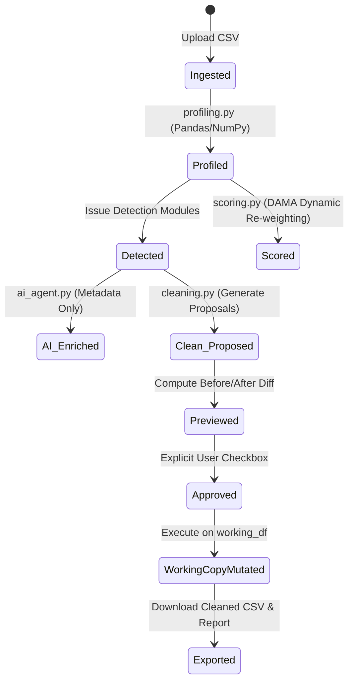

# Phase 1: Data Model & Schema Specifications

**Feature**: DataGuard AI – Intelligent Data Quality & Anomaly Detection Agent  
**Branch**: `001-data-quality-agent`  
**Date**: 2026-11-19  

## Overview
This document specifies the core domain models, enums, data contracts, and state transitions for DataGuard AI. These models are implemented in pure Python using `dataclasses` and `typing` with strict type annotations, completely decoupled from any UI or web framework.

---

## 1. Domain Enums

```python
from enum import Enum

class InferredDataType(str, Enum):
    NUMERIC = "numeric"
    CATEGORICAL = "categorical"
    DATETIME = "datetime"
    TEXT = "text"
    BOOLEAN = "boolean"
    UNKNOWN = "unknown"

class IssueCategory(str, Enum):
    MISSING_VALUE = "missing_value"
    EXACT_DUPLICATE_ROW = "exact_duplicate_row"
    BUSINESS_KEY_DUPLICATE = "business_key_duplicate"
    NUMERIC_OUTLIER = "numeric_outlier"
    CASING_INCONSISTENCY = "casing_inconsistency"
    WHITESPACE_INCONSISTENCY = "whitespace_inconsistency"
    ALIAS_INCONSISTENCY = "alias_inconsistency"
    SPELLING_INCONSISTENCY = "spelling_inconsistency"
    FORMAT_ANOMALY = "format_anomaly"
    UNKNOWN_COLUMN = "unknown_column"

class IssueSeverity(str, Enum):
    CRITICAL = "critical"      # Blocking or severe data loss/corruption
    HIGH = "high"              # High rate of nulls or primary key collision
    MEDIUM = "medium"          # Inconsistent aliases, casing differences
    LOW = "low"                # Minor whitespace variations
    ADVISORY = "advisory"      # Statistical outliers that may be legitimate

class ConfidenceTier(str, Enum):
    COSMETIC = "cosmetic"             # 100% deterministic (strip, lowercase)
    HIGH_CONFIDENCE = "high"          # >= 90% (dictionary alias, exact token match)
    MEDIUM_CONFIDENCE = "medium"      # 80% - 89% (fuzzy spelling suggestion)
    LOW_CONFIDENCE = "low"            # < 80% (ambiguous / kept distinct)

class CleaningActionType(str, Enum):
    DROP_EXACT_DUPLICATES = "drop_exact_duplicates"
    RESOLVE_KEY_DUPLICATES = "resolve_key_duplicates"
    IMPUTE_MISSING = "impute_missing"
    DROP_MISSING_ROWS = "drop_missing_rows"
    TRIM_WHITESPACE = "trim_whitespace"
    STANDARDIZE_CASING = "standardize_casing"
    MAP_ALIASES = "map_aliases"
    FUZZY_STANDARDIZE = "fuzzy_standardize"
    CAP_OUTLIERS = "cap_outliers"

class ProposalStatus(str, Enum):
    PENDING = "pending"
    APPLIED = "applied"
    REJECTED = "rejected"
```

---

## 2. Core Domain Dataclasses

### A. Profiling & Dataset Structure

```python
from dataclasses import dataclass, field
from typing import Dict, List, Any, Optional

@dataclass
class DatasetMetadata:
    filename: str
    file_size_bytes: int
    row_count: int
    column_count: int
    ingestion_timestamp: str

@dataclass
class ColumnStatistics:
    # Numeric stats
    min_val: Optional[float] = None
    max_val: Optional[float] = None
    mean_val: Optional[float] = None
    median_val: Optional[float] = None
    std_val: Optional[float] = None
    q1_val: Optional[float] = None
    q3_val: Optional[float] = None
    iqr_val: Optional[float] = None
    lower_bound: Optional[float] = None
    upper_bound: Optional[float] = None
    # Categorical stats
    top_categories: Dict[str, int] = field(default_factory=dict)
    sample_values: List[Any] = field(default_factory=list)

@dataclass
class ColumnProfile:
    column_name: str
    inferred_type: InferredDataType
    total_count: int
    null_count: int
    null_percentage: float
    unique_count: int
    unique_percentage: float
    is_business_key: bool = False
    statistics: ColumnStatistics = field(default_factory=ColumnStatistics)

@dataclass
class DatasetProfile:
    metadata: DatasetMetadata
    columns: Dict[str, ColumnProfile]
    warnings: List[str] = field(default_factory=list)
```

---

### B. Quality Issues & Anomalies

```python
@dataclass
class QualityIssue:
    issue_id: str
    category: IssueCategory
    column_name: Optional[str]
    severity: IssueSeverity
    affected_count: int
    affected_percentage: float
    sample_values: List[Any]
    sample_row_indices: List[int]
    explanation: str
    confidence_tier: Optional[ConfidenceTier] = None
    is_advisory: bool = False
    suggested_action: Optional[CleaningActionType] = None
```

---

### C. Quality Scoring & Dimensions

```python
@dataclass
class DimensionScore:
    completeness: float     # 0.0 to 100.0
    validity: float         # 0.0 to 100.0
    consistency: float      # 0.0 to 100.0
    uniqueness: float       # 0.0 to 100.0
    active_weights: Dict[str, float] = field(default_factory=dict)

@dataclass
class QualityScorecard:
    overall_score: float                              # 0.0 to 100.0
    dataset_uniqueness_score: float                   # 0.0 to 100.0
    column_scores: Dict[str, float] = field(default_factory=dict)
    column_dimensions: Dict[str, DimensionScore] = field(default_factory=dict)
    deduction_reasons: List[str] = field(default_factory=list)
```

---

### D. AI Explanations & Semantic Insights

```python
@dataclass
class ColumnSemanticInference:
    column_name: str
    suggested_meaning: str
    confidence: float
    candidate_rules: List[str]
    is_uncertain: bool

class ProviderSource(str, Enum):
    GEMINI = "Gemini"
    GROQ = "Groq"
    PYTHON_TEMPLATE = "Python Template Fallback"

class LLMErrorCategory(str, Enum):
    AUTHENTICATION = "authentication"
    RATE_LIMIT = "rate_limit"
    MODEL_UNAVAILABLE = "model_unavailable"
    TIMEOUT = "timeout"
    SERVER_ERROR = "server_error"
    UNKNOWN = "unknown"

@dataclass
class ProviderStatusReport:
    active_provider: ProviderSource
    active_model: str
    gemini_healthy: bool
    groq_healthy: bool
    last_error_message: Optional[str] = None
    last_error_category: Optional[LLMErrorCategory] = None

@dataclass
class AIExplanation:
    issue_id: str
    plain_english_summary: str
    business_impact: str
    recommended_fix: str
    suggested_python_code: str
    provider_source: ProviderSource = ProviderSource.GEMINI
    model_name: str = "gemini-2.5-flash"
    is_fallback: bool = False  # True when generated by offline rule template
```

---

### E. Cleaning & Transformation Contracts

```python
@dataclass
class ValueMapping:
    original_value: str
    replacement_value: str
    confidence_tier: ConfidenceTier
    similarity_score: float
    frequency: int
    is_approved: bool = False

@dataclass
class CleaningProposal:
    proposal_id: str
    action_type: CleaningActionType
    column_name: Optional[str]
    parameters: Dict[str, Any]
    affected_rows: int
    status: ProposalStatus = ProposalStatus.PENDING
    value_mappings: List[ValueMapping] = field(default_factory=list)
```

---

## 3. Entity Relationships & State Flow


