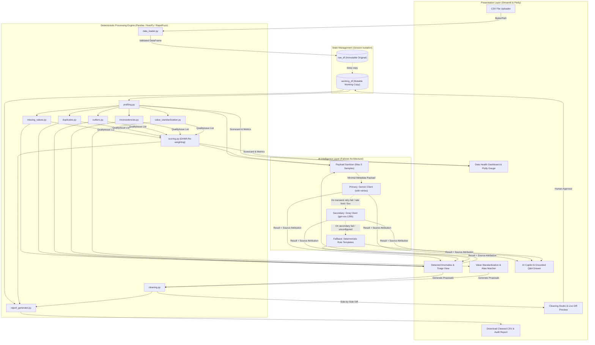

# Implementation Plan: DataGuard AI – Intelligent Data Quality & Anomaly Detection Agent

**Branch**: `001-data-quality-agent` | **Date**: 2026-11-19 | **Spec**: [specs/001-data-quality-agent/spec.md](spec.md)

**Input**: Feature specification from `/specs/001-data-quality-agent/spec.md`

## Summary
DataGuard AI is an intelligent data quality and anomaly detection application designed for Data Analysts, Data Engineers, and Business stakeholders. It combines deterministic Python profiling (Pandas, NumPy, RapidFuzz) with an LLM assistant (Gemini API) to profile CSV datasets (up to ~10,000 rows), detect multi-category anomalies (missing values, exact/key duplicates, outliers, casing/alias inconsistencies), compute proportional DAMA-aligned quality scores, explain defects in plain English, and safely apply human-approved cleanings with before-and-after live previews while strictly preserving the original raw data.

---

## Technical Context

**Language/Version**: Python 3.10+ (tested on Python 3.14)  
**Primary Dependencies**:
- Web UI & Visualizations: Streamlit, Plotly
- Deterministic Processing & Detection: Pandas, NumPy
- String Matching & Similarity: RapidFuzz, Python `re`
- AI Assistant & Copilot: Pluggable Multi-Provider Architecture (Primary: Gemini via `google-genai`; Secondary: Groq via `groq` SDK with `openai/gpt-oss-120b`; Fallback: deterministic Python rule templates), `python-dotenv`
- Testing: Pytest  
**Storage**: In-memory session state (`st.session_state`) maintaining immutable `raw_df` and mutable `working_df`; exported downloadable CSV & HTML/Markdown reports  
**Target Platform**: Cross-platform (Windows, macOS, Linux) web application running locally via Streamlit  
**Project Type**: Standalone Web Application & Modular Python Package  
**Performance Goals**: Complete ingestion, profiling, anomaly detection, and scoring of up to 10,000 rows across 30 columns in `< 5 seconds`  
**Constraints**:
- Strict data privacy: zero full CSV rows sent to LLM (max 5 distinct sanitized samples per column)
- Non-negotiable human approval: zero automatic data mutations
- Multi-provider automatic failover: Gemini (primary with 2 retries) → Groq (secondary: `openai/gpt-oss-120b`) → deterministic Python templates fallback
- Attribution & Transparency: Every AI output displays its provider source badge (`Gemini`, `Groq`, or `Python Template Fallback`); zero API keys exposed in logs or UI
- No execution of arbitrary LLM-generated code  
**Scale/Scope**: Single CSV file up to ~10,000 rows for MVP; 12 dedicated functional modules  

---

## Constitution Check

*GATE: Must pass before Phase 0 research. Re-check after Phase 1 design.*

| Principle | Requirement | Plan Alignment | Status |
|---|---|---|:---:|
| **I. Modular Architecture** | Separate modules with clear interfaces | 12 dedicated single-responsibility modules in `src/` | **PASSED** |
| **II. Separation of Concerns** | Profiling, detection, scoring, AI, cleaning, and reporting strictly decoupled | Independent modules with defined input/output contracts | **PASSED** |
| **III. Python-First Detection** | Pandas & NumPy compute all metrics; LLM never does math | 100% deterministic detection & scoring in pure Python | **PASSED** |
| **IV. AI as an Assistant** | LLM provides explanations and semantic inferences only | LLM outputs structured narrative guidance; never alters data | **PASSED** |
| **V. Human Approval** | Never mutate or delete data without explicit confirmation | Cleaning proposals require checkbox review & confirmation button | **PASSED** |
| **VI. Data Preservation** | Original uploaded dataset is immutable | `raw_df` is immutable; `working_df` receives approved edits | **PASSED** |
| **VII. Explainability** | Every issue has category, affected column, count, samples, and explanation | `QualityIssue` dataclass encapsulates complete audit fields | **PASSED** |
| **VIII. Testability** | Unit tests for detection and scoring | Pytest suite covering all deterministic modules in `tests/` | **PASSED** |
| **IX. Security** | API keys via `.env` and `.gitignore` | `python-dotenv` with `.env` git-ignored and `.env.example` provided | **PASSED** |
| **X. Privacy** | Never send full CSV to external LLM | Strict payload contract: metadata + max 5 sanitized samples | **PASSED** |
| **XI. Reliability** | Graceful error handling for missing columns, mixed types, empty CSVs | Robust type-checking, empty-file checks, and error boundaries | **PASSED** |
| **XII. Performance** | Support CSV files up to ~10,000 rows | Vectorized Pandas/NumPy operations execute in < 250ms | **PASSED** |
| **XIII. Maintainability** | Meaningful naming, type hints, docstrings | Python type annotations and clean docstrings across all modules | **PASSED** |
| **XIV. Hackathon Scope** | Prioritize working end-to-end app over complexity | Streamlit single-process web app delivering full user journey | **PASSED** |

*All 14 principles verified and satisfied. Zero constitutional violations.*

---

## Project Structure

### Documentation (this feature)

```text
specs/001-data-quality-agent/
├── spec.md              # Feature specification with clarifications
├── plan.md              # This implementation plan
├── research.md          # Technical decisions and rationale
├── data-model.md        # Dataclass schemas and entity relationships
├── quickstart.md        # Setup, execution, and verification guide
├── contracts/           # Module interface contracts
│   ├── detection_contracts.md
│   ├── scoring_contract.md
│   ├── ai_agent_contract.md
│   ├── cleaning_contract.md
│   └── report_contract.md
├── checklists/
│   └── requirements.md  # Quality checklist (16/16 pass)
└── tasks.md             # Implementation tasks (created in next step)
```

### Source Code (repository root)

```text
hackathon/
├── app.py                      # Streamlit entry point, multi-tab layout & state orchestration
├── src/
│   ├── __init__.py
│   ├── models.py               # Shared domain dataclasses, enums, and data models
│   ├── data_loader.py          # CSV loading, encoding validation, and bounds checking
│   ├── profiling.py            # Dynamic data profiling and statistical summaries
│   ├── missing_values.py       # Null, empty-string, and whitespace anomaly detection
│   ├── duplicates.py           # Dual-tier exact row and business-key duplicate detection
│   ├── outliers.py             # IQR and Z-score numerical outlier detection (advisory)
│   ├── inconsistencies.py      # Casing, whitespace, and formatting anomaly detection
│   ├── value_standardization.py# RapidFuzz and dictionary-based alias normalization
│   ├── scoring.py              # DAMA-aligned dynamic re-weighting quality scoring engine
│   ├── ai_agent.py             # Gemini API client, privacy payload sanitization, fallback
│   ├── cleaning.py             # Before/after diff preview, approval, and safe mutation
│   └── report_generator.py     # Downloadable HTML and Markdown audit report generator
├── config/
│   └── aliases.json            # Configurable alias mappings (e.g. city variations)
├── tests/
│   ├── __init__.py
│   ├── conftest.py             # Test fixtures and synthetic benchmark CSVs
│   ├── test_data_loader.py     # Ingestion and error handling tests
│   ├── test_profiling.py       # Column profiling and type inference tests
│   ├── test_detection.py       # Missing values, duplicates, outliers, inconsistencies
│   ├── test_standardization.py # RapidFuzz confidence tiers and alias resolution
│   ├── test_scoring.py         # Proportional re-weighting math and edge cases
│   ├── test_cleaning.py        # Data preservation immutability and preview diffs
│   └── test_ai_agent.py        # Payload privacy contract and offline fallback
├── .env.example
├── .gitignore
├── requirements.txt
└── README.md
```

---

## Component Architecture & Data Flow



---

## Multi-Provider LLM & Automatic Failover Architecture

The AI copilot layer in `src/ai_agent.py` implements a resilient multi-provider strategy satisfying all privacy, security, and uptime requirements:

### 1. Provider Implementations & Shared Protocol
* **`LLMProviderProtocol`**: Common Python `Protocol` defining:
  * `generate_json(prompt: str, schema: dict) -> dict`
  * `answer_query(system_prompt: str, user_query: str) -> str`
  * Attributes: `name: str`, `model_name: str`, `is_configured: bool`.
* **`GeminiProvider`**: Primary provider implemented using the `google-genai` SDK.
  * Environment configuration: `GEMINI_API_KEY`, `GEMINI_MODEL` (default: `gemini-2.5-flash`).
* **`GroqProvider`**: Secondary provider implemented using the official `groq` Python SDK.
  * Environment configuration: `GROQ_API_KEY`, `GROQ_MODEL` (default: `openai/gpt-oss-120b`).

### 2. Error Classification Taxonomy & Bounded Backoff
Every exception caught from external SDK calls passes through `classify_llm_error()`:
* **`AUTHENTICATION`** (401, 403, missing key): Non-transient. Skips retries and immediately switches to secondary provider or fallback.
* **`MODEL_UNAVAILABLE`** (404, model deprecated/not provisioned): Non-transient. Immediately switches to secondary provider.
* **`RATE_LIMIT`** (HTTP 429): Transient. Reads `Retry-After` if present; performs up to 1 bounded retry before triggering failover.
* **`TIMEOUT`** / **`SERVER_ERROR`** (5xx, connection drop): Transient. Retried using bounded exponential backoff with jitter:
  $$\text{delay} = \min\left(4.0,\ 1.0 \times 2^{\text{attempt}}\right) + \text{uniform}(0, 0.5)$$
  Max retries capped at 2.

### 3. Failover Orchestration (`LLMProviderManager`)
* **Execution Flow**:
  1. `GeminiProvider`: Attempt call with bounded backoff for transient glitches.
  2. `GroqProvider`: Engage immediately upon Gemini rate limits, timeouts, model issues, or auth failures.
  3. `TemplateExplanationEngine`: Engage immediately if Groq also fails or if no API keys are configured.
* **Output Guarantee**: Every request returns a tuple: `(result_data, ProviderSource, model_name)`. Zero unhandled exceptions propagate to the UI or core pipelines.

### 4. Privacy & Zero-LLM Determinism
* **Privacy Contract**: Only column names, inferred types, null%, summary statistics, and max 5 sanitized distinct samples are provided to LLMs. Zero full CSV rows ever leave the machine.
* **Zero Secret Exposure**: API keys are scrubbed and never appear in error banners, UI components, or logs.
* **Zero-LLM Pipeline Integrity**: All CSV loading, dynamic profiling, anomaly detection, quality scoring (DAMA re-weighting), before/after diff preview, human-approved cleaning, and audit report generation function 100% deterministically without any LLM keys or internet connection.

### 5. Streamlit Provider Status Reporting
* The Streamlit sidebar renders a real-time status component:
  * Visual badge: `🟢 Gemini (Primary)` / `🟡 Groq (Failover Active)` / `⚪ Python Template (Offline Mode)`.
  * Active model indicator (e.g. `openai/gpt-oss-120b`).
  * Informational banner if failover occurred (e.g. *"Gemini rate limit encountered; failover to Groq successful"*).

### 6. Verification & Fallback Test Suite (`tests/test_ai_agent.py`)
Automated Pytest suite verifying all 5 failover permutations:
1. `test_gemini_success`: Primary healthy execution with `ProviderSource.GEMINI`.
2. `test_gemini_rate_limit_failover_to_groq`: Mock Gemini 429 triggers Groq with `ProviderSource.GROQ`.
3. `test_gemini_auth_error_immediate_failover`: Mock Gemini 401 triggers Groq with zero delay.
4. `test_dual_provider_outage_template_fallback`: Both providers raise exceptions → Fallback template outputs valid `AIExplanation` with `ProviderSource.PYTHON_TEMPLATE`.
5. `test_zero_llm_core_pipelines`: Upload, profile, detect, score, clean, and report execute cleanly without API keys.

---

## Complexity Tracking

> *No constitutional violations. Zero unnecessary architectural abstractions.*

| Potential Complexity | Decision | Rationale |
|---|---|---|
| Distributed task queue (Celery/Redis) | **Rejected** | Pandas processes 10,000 rows in < 250ms in-memory; background queue violates hackathon simplicity. |
| External database (PostgreSQL/SQLite) | **Rejected** | Session state in Streamlit with immutable copy satisfies data preservation without DB overhead. |
| Automatic code execution by LLM | **Rejected** | Strictly forbidden by Constitution Principle IV & V; all cleaning runs verified Python routines. |
