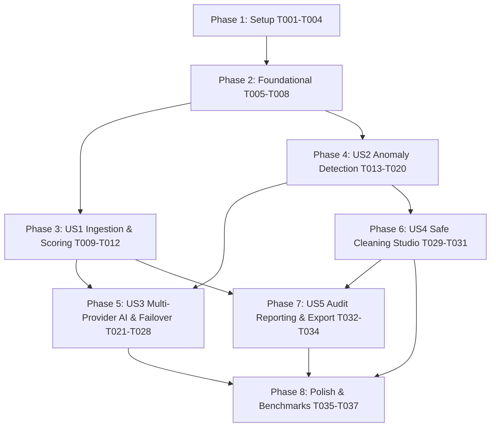

# Tasks: DataGuard AI – Intelligent Data Quality & Anomaly Detection Agent

**Input**: Design documents from `/specs/001-data-quality-agent/` (`spec.md`, `plan.md`, `data-model.md`, `research.md`, `contracts/`, `quickstart.md`)  
**Prerequisites**: `plan.md`, `spec.md`, `data-model.md`, `contracts/`  
**Constitution**: Aligned with all 14 non-negotiable principles of DataGuard AI  
**Team Allocation**: Suitable for a 4-member hackathon team (Data Core, Detection/Standardization, Multi-Provider AI, UI/Reporting)  

---

## Format: `[ID] [P?] [Story?] Description with file path`

- **[P]**: Can run in parallel (different files, no dependencies)
- **[Story]**: Associated user story (`[US1]`, `[US2]`, `[US3]`, `[US4]`, `[US5]`)
- Concrete file paths are provided for every task

---

## Phase 1: Setup & Shared Infrastructure

**Purpose**: Project initialization, dependency management, environment isolation, and shared schemas.

- [X] T001 Initialize repository structure, virtualenv configuration, and core package requirements (streamlit, pandas, numpy, rapidfuzz, plotly, google-genai, groq, python-dotenv, pytest) in `requirements.txt`
- [X] T002 [P] Configure environment template for dual LLM providers (`GEMINI_API_KEY`, `GEMINI_MODEL`, `GROQ_API_KEY`, `GROQ_MODEL`) in `.env.example` and verify exclusions in `.gitignore`
- [X] T003 [P] Create initial configurable reference alias dictionary for cities and standard business synonyms in `config/aliases.json`
- [X] T004 [P] Implement core domain dataclasses, enums, error categories, and provider sources (`DatasetProfile`, `QualityIssue`, `QualityScorecard`, `LLMErrorCategory`, `ProviderSource`, `CleaningProposal`) in `src/models.py`

---

## Phase 2: Foundational (Blocking Prerequisites)

**Purpose**: Core deterministic processing, dynamic profiling, and baseline test infrastructure that all user stories depend on.

- [X] T005 Implement resilient CSV ingestion, encoding auto-detection, and row limit boundary checks in `src/data_loader.py`
- [X] T006 [P] Implement dynamic column profiling, data type inference, and numerical/categorical distribution metrics (IQR bounds, std dev, frequencies) in `src/profiling.py`
- [X] T007 [P] Implement DAMA-aligned dynamic proportional re-weighting scoring engine (Completeness 35%, Validity 30%, Consistency 25%, Uniqueness 10%) in `src/scoring.py`
- [X] T008 Implement automated Pytest fixtures and synthetic dirty benchmark CSV generator in `tests/conftest.py`

**Checkpoint**: Core data processing, profiling, and scoring models ready. User story implementation can proceed in parallel.

---

## Phase 3: User Story 1 - Dataset Ingestion, Dynamic Profiling & Quality Scoring (Priority: P1) 🎯 MVP

**Goal**: Deliver an automated data health dashboard where users upload a CSV file and immediately view structural metadata, column distributions, and a composite quality score.  
**Independent Test**: Upload a 10,000-row CSV; verify file summary, inferred types, missing/unique percentages, and overall/column scores render within 5 seconds.

### Tests for User Story 1
- [X] T009 [P] [US1] Unit tests for data loading, encoding detection, and empty/corrupt file handling in `tests/test_data_loader.py`
- [X] T010 [P] [US1] Unit tests for dynamic type inference and proportional scoring calculation in `tests/test_profiling.py` and `tests/test_scoring.py`

### Implementation for User Story 1
- [X] T011 [US1] Implement Streamlit file upload interface, session state isolation (`raw_df` immutable vs `working_df`), and top-level summary metrics in `app.py`
- [X] T012 [US1] Implement interactive column statistics explorer and Plotly radial/gauge quality scorecard component in `app.py`

**Checkpoint**: User Story 1 complete. Users can upload CSVs and view deterministic data quality scores.

---

## Phase 4: User Story 2 - Deterministic Multi-Category Issue & Anomaly Detection (Priority: P1) 🎯 MVP

**Goal**: Implement deterministic anomaly detection across missing values, duplicates, numeric outliers, and casing/whitespace inconsistencies.  
**Independent Test**: Run detection on synthetic benchmark CSV seeded with known errors; verify exact defect counts, sample records, and advisory classifications match ground truth.

### Implementation for User Story 2
- [X] T013 [P] [US2] Implement missing-value detection (nulls, empty strings, whitespace-only entries) in `src/missing_values.py`
- [X] T014 [P] [US2] Implement dual-tier duplicate detection (100% exact full-row duplicates vs user-designated business keys) in `src/duplicates.py`
- [X] T015 [P] [US2] Implement IQR and Z-score outlier detection with advisory anomaly triage classification (non-penalizing default) in `src/outliers.py`
- [X] T016 [P] [US2] Implement casing and whitespace inconsistency detection in `src/inconsistencies.py`
- [X] T017 [P] [US2] Implement RapidFuzz string similarity and dictionary alias matching with confidence tiers (Cosmetic, High ≥90%, Medium 80–89%, Distinct <80%) in `src/value_standardization.py`
- [X] T018 [US2] Unit tests for all deterministic detection modules and standardization tiers in `tests/test_detection.py` and `tests/test_standardization.py`
- [X] T019 [US2] Implement "Detected Anomalies" dashboard tab with category filter pills and outlier triage controls in `app.py`
- [X] T020 [US2] Implement "Value Standardization" review tab displaying detected text clusters and suggested canonical mappings in `app.py`

**Checkpoint**: User Story 2 complete. All deterministic data quality anomalies are detected, categorized, and inspectable with sample rows.

---

## Phase 5: User Story 3 - AI Explanations, Multi-Provider Architecture & Automatic Failover (Priority: P2)

**Goal**: Implement a multi-provider LLM copilot (Gemini primary, Groq secondary, Python template fallback) that explains issues in plain English, suggests candidate rules, answers grounded questions, and displays visual provider attribution badges with zero raw dataset leakage.  
**Independent Test**: Trigger an explanation when Gemini is offline; verify system retries, fails over to Groq (`openai/gpt-oss-120b`) or template fallback, displays source attribution, and preserves core app uptime.

### Implementation for User Story 3
- [X] T021 [P] [US3] Implement `LLMProviderProtocol` and error classification taxonomy (`classify_llm_error` for 401/403, 429, 404, timeouts, 5xx) in `src/ai_agent.py`
- [X] T022 [P] [US3] Implement `GeminiProvider` using the `google-genai` SDK with environment credential loading in `src/ai_agent.py`
- [X] T023 [P] [US3] Implement `GroqProvider` using the official `groq` SDK with model `openai/gpt-oss-120b` in `src/ai_agent.py`
- [X] T024 [US3] Implement `LLMProviderManager` with provider routing (Gemini primary, Groq secondary), bounded exponential backoff with jitter for transient errors, and transparent failover in `src/ai_agent.py`
- [X] T025 [P] [US3] Implement deterministic rule-based template explanation engine (`TemplateExplanationEngine`) for zero-LLM fallback in `src/ai_agent.py`
- [X] T026 [US3] Implement privacy payload sanitizer (strictly metadata + max 5 sanitized samples) and grounded Q&A prompt generator in `src/ai_agent.py`
- [X] T027 [US3] Comprehensive unit and integration tests for all failover scenarios (Gemini success, Groq 429 failover, 401 immediate failover, dual outage template fallback, credential scrubbing) in `tests/test_ai_agent.py`
- [X] T028 [US3] Implement Streamlit provider status indicator pill (`Gemini` / `Groq` / `Python Template Fallback`), model details banner, and grounded chat sidebar in `app.py`

**Checkpoint**: User Story 3 complete. Intelligent explanations and interactive Q&A operate with automatic failover and zero data privacy leakage.

---

## Phase 6: User Story 4 - Smart Standardization & Human-Approved Cleaning with Live Preview (Priority: P2)

**Goal**: Enable users to review proposed data cleaning operations, inspect before-and-after diffs, and approve transformations on `working_df` while strictly preserving `raw_df`.  
**Independent Test**: Select a proposed city standardization, preview before/after diff table, click approve, and confirm `working_df` is updated while `raw_df` remains completely unchanged.

### Implementation for User Story 4
- [X] T029 [P] [US4] Implement cleaning proposal generators, side-by-side before/after preview diff generator, and safe mutation routines (deduplication, whitespace trim, casing, alias map, impute) in `src/cleaning.py`
- [X] T030 [US4] Unit tests verifying that `raw_df` is immutable, diff previews are accurate, and transformations mutate only `working_df` in `tests/test_cleaning.py`
- [X] T031 [US4] Implement "Cleaning Studio" tab in `app.py` with before-and-after sample diffs, approval checkboxes, and "Apply Transformation" confirmation button

**Checkpoint**: User Story 4 complete. Safe, auditable, human-in-the-loop cleaning is operational.

---

## Phase 7: User Story 5 - Comprehensive Audit Reporting & Clean Data Export (Priority: P3)

**Goal**: Generate standalone executive quality audit reports (Markdown/HTML) and enable one-click download of the cleaned CSV.  
**Independent Test**: Apply cleaning actions and download both the cleaned CSV and HTML audit report; verify all applied changes, quality scores, and provider provenance are reflected.

### Implementation for User Story 5
- [X] T032 [P] [US5] Implement executive Markdown and styled standalone HTML audit report generator with embedded scorecard and change history in `src/report_generator.py`
- [X] T033 [US5] Unit tests verifying HTML/Markdown report formatting, score representation, and cleaned CSV export in `tests/test_report.py`
- [X] T034 [US5] Integrate cleaned CSV export download button and HTML/Markdown report downloaders into the export panel in `app.py`

**Checkpoint**: User Story 5 complete. Full audit reporting and clean data export verified.

---

## Phase 8: Polish, Multi-Provider Integration & Benchmark Validation

**Purpose**: Cross-cutting validation, 10k-row performance benchmarking, and hackathon presentation polish.

- [X] T035 [P] Create end-to-end performance benchmark test asserting complete ingestion, profiling, detection, and scoring of 10,000 rows executes in < 5 seconds in `tests/test_benchmark.py`
- [X] T036 [P] Verify security and privacy boundary: assert zero API keys appear in logs, error banners, or UI components
- [X] T037 Create comprehensive `README.md` containing hackathon architecture diagrams, environment setup, quickstart commands, and sample test dataset instructions

---

## Dependencies & Completion Order

---

## Hackathon Team Workstream Parallelization (4 Engineers)

| Engineer | Focus Area | Primary Tasks Owned |
|---|---|---|
| **Engineer 1 (Core Processing & Scoring)** | Data Loading, Dynamic Profiling, DAMA Scoring Engine | `T005`, `T006`, `T007`, `T008`, `T010` |
| **Engineer 2 (Detection & Standardization)** | Missing Values, Duplicates, Outliers, Inconsistencies, RapidFuzz | `T003`, `T013`, `T014`, `T015`, `T016`, `T017`, `T018` |
| **Engineer 3 (Multi-Provider AI & Failover)** | GeminiProvider, GroqProvider, LLMProviderManager, Backoff, Fallback | `T002`, `T021`, `T022`, `T023`, `T024`, `T025`, `T026`, `T027` |
| **Engineer 4 (Streamlit UI & Cleaning Studio)** | Streamlit Layout, Plotly Gauges, Diff Previews, Report Generator | `T001`, `T004`, `T011`, `T012`, `T019`, `T020`, `T028`, `T029`, `T031`, `T032`, `T034` |

---

## Implementation Strategy & MVP Scope

1. **MVP Increment 1 (Foundations + US1 & US2)**: Deliver working file upload, profiling, deterministic anomaly detection, and scoring dashboard (`T001`–`T020`). Delivers a complete, demonstratable data health tool even before AI is connected.
2. **MVP Increment 2 (US3 - Multi-Provider AI)**: Connect `GeminiProvider`, `GroqProvider`, and `TemplateExplanationEngine` with automatic failover (`T021`–`T028`).
3. **MVP Increment 3 (US4 & US5 - Cleaning & Export)**: Enable before/after preview, human approval, clean CSV export, and audit report generation (`T029`–`T034`).
4. **Final Polish**: Performance benchmarking (< 5s for 10k rows) and demo preparation (`T035`–`T037`).
